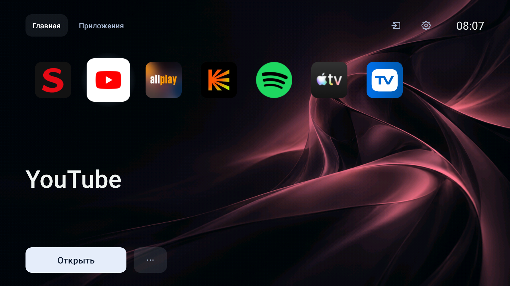

# LightLauncher

Лёгкий домашний экран для Android TV: избранные приложения, управление пультом и полноэкранный фон. Java и нативные Android Views, без рекламы и аналитики.



Скриншот LightLauncher 1.3.3 на Xiaomi MiTV-MSSP1. Раньше проект назывался «Дома».

[Скачать APK](https://github.com/shaxaydev/lightlauncher/releases/latest) · [MIT](LICENSE) · [Инструкции для агентов](#agent-instructions)

## Возможности

### Главный экран

- Горизонтальная лента значков без внешних рамок и рекламных рекомендаций.
- Полноэкранный абстрактный фон с плавной сменой оттенка под выбранное приложение.
- Цветовые акценты для YouTube, Spotify, Кинопоиска, Allplay, Apple TV, Иви и Okko; для остальных — общий синий. Автоматического извлечения цвета из иконки нет.
- Увеличение и подсветка выбранной иконки, название приложения и кнопка запуска, следующие за выбором.
- Кнопки «Открыть» и «•••» для запуска и действий с выбранным приложением.
- Часы в формате 24 часа, быстрый доступ к системным настройкам и ТВ-входам.
- Компактные кнопки-иконки для входов, настроек и действий с приложением. Иконки центрированы, названия сохранены для озвучивания; их цвет меняется при фокусе. «Главная» и «Приложения» остаются текстовыми.
- Полноэкранный горизонтальный интерфейс без постоянных подсказок и счётчиков.

### Приложения и избранное

- «Главная» с избранным и «Приложения» со всеми найденными запускаемыми приложениями.
- Обнаружение Android TV-приложений и обычных приложений с launcher Activity.
- Названия и иконки из установленных пакетов, сортировка с учётом языка системы.
- Добавление и удаление избранного, перемещение раньше/позже, системная страница приложения.
- Локальное сохранение порядка между перезапусками и совместимыми обновлениями APK.
- Обновление списка по событиям установки, удаления и изменения приложений.
- Восстановление фокуса при перестроении ленты после действий меню. Home намеренно возвращает к началу главного экрана.
- Сам LightLauncher и известные штатные launcher-пакеты Xiaomi/Google исключены из ленты. Произвольного скрытия приложений пока нет.
- Первый запуск заполняет избранное установленными приложениями из небольшого стартового списка. Если их нет, доступен раздел «Приложения». Пустое избранное допустимо.

### ТВ-интеграция

- HOME Activity: можно назначить домашним экраном по умолчанию.
- Запуск после перезагрузки зависит от назначения HOME и прошивки, а не от отдельного сервиса автозапуска.
- Меню входов через `TvInputManager`: доступные HDMI и другие passthrough-входы, пользовательские названия и пометка отсутствия сигнала.
- Резервный переход в ТВ-приложение MediaTek на поддерживаемой прошивке.
- Сообщения об ошибках запуска приложений и недоступных ТВ-входах.

### Производительность и приватность

- Ноль сторонних runtime-зависимостей, сервисов и сетевых разрешений.
- Подготовка оттенков фона вне UI-потока.
- Кеш иконок — до 2 МиБ, подготовленных фонов — до 6 МиБ. Это лимиты кешей, не общий расход памяти процесса.
- Переход фона — 180 мс, фокус — 130 мс. В покое постоянная анимация не работает.
- Нет аналитики, аккаунтов, сетевой загрузки контента или фонового опроса приложений.
- Реклама и поведение запускаемых приложений лаунчером не изменяются.

AirPlay исследуется отдельным прототипом. Приёмника AirPlay и его библиотек в этом репозитории и APK нет. SHAXFLIX также является отдельным проектом.

## Управление пультом

| Кнопка | Действие |
|---|---|
| Влево / вправо | Приложения или кнопки меню |
| OK | Запуск приложения или выбранного действия |
| Вниз от иконки | Кнопка «Открыть» |
| Вверх от кнопки запуска | Выбранная иконка |
| Вверх от иконки | Верхняя навигация |
| Долгое OK на иконке | Меню избранного и порядка |
| Menu на пульте | Действия с приложением, когда фокус находится в ленте |
| «•••» | Действия с выбранным приложением |
| Назад из «Приложения» | Избранное |
| Назад на главной | Начало ленты |
| Home | Главная после назначения домашним приложением |

## Совместимость и ограничения

- Минимум Android 9 / API 28. Compile/target SDK — 35, Java — 17.
- Проверенный телевизор: Xiaomi MiTV-MSSP1 (`nino`), Android TV 9, PI.5925, 1920×1080 / 320 dpi.
- Java-приложение без JNI/NDK; 32-битная среда этого Xiaomi поддерживается.
- Телефонный эмулятор служит для проверки логики и D-pad. Это не подтверждение поддержки телефонов или всех моделей ТВ.
- Переключение HDMI, физический пульт, холодное включение, HOME и производительность проверяются на реальном телевизоре. Результаты одной модели не распространяются на другие устройства.
- Интерфейс пока русский; тексты вынесены в Android-ресурсы для последующих переводов.
- Настроек качества фона, пользовательских обоев, редактирования стартового списка и управления AirPlay пока нет.

## Установка

Скачайте APK из [Releases](https://github.com/shaxaydev/lightlauncher/releases/latest). Для ADB включите отладку и разрешите подключение компьютера на самом ТВ.

```sh
adb connect TV_IP:5555
adb -s TV_IP:5555 install -r lightlauncher-1.3.3.apk
adb -s TV_IP:5555 shell am start -W -n uz.shaxay.tvhome/.MainActivity
```

Сначала проверьте запуск, приложения и пульт. Затем выберите LightLauncher в системных настройках домашнего экрана или назначьте через ADB:

```sh
# Сохраните результат: исходный HOME для отката.
adb -s TV_IP:5555 shell cmd package resolve-activity --brief \
  -a android.intent.action.MAIN -c android.intent.category.HOME

adb -s TV_IP:5555 shell cmd package set-home-activity --user 0 uz.shaxay.tvhome/.MainActivity
adb -s TV_IP:5555 shell input keyevent KEYCODE_HOME
```

### Особенность Xiaomi PI.5925

На проверенном MiTV штатный Home имеет повышенный приоритет. Обычного назначения HOME может быть недостаточно. Команды ниже относятся к этой прошивке, **не являются универсальными для Android TV** и выполняются после проверки LightLauncher и сохранения доступа по ADB:

```sh
adb -s TV_IP:5555 shell pm disable-user --user 0 com.google.android.tvlauncher
adb -s TV_IP:5555 shell pm disable-user --user 0 com.mitv.tvhome.atv
adb -s TV_IP:5555 shell cmd package set-home-activity --user 0 uz.shaxay.tvhome/.MainActivity
adb -s TV_IP:5555 shell input keyevent KEYCODE_HOME
```

Отключение для пользователя 0 сохраняет пакеты и их данные. Системный FallbackHome удалять или отключать не нужно.

### Возврат штатного лаунчера

Для проверенного Xiaomi:

```sh
./restore-stock.sh TV_IP:5555
```

Скрипт возвращает PatchWall в состояние по умолчанию, включает Google TV Launcher и назначает его HOME. На других устройствах используйте сохранённый компонент исходного HOME и команды для его пакетов.

Пакет остаётся `uz.shaxay.tvhome` для обновления прежних установок «Дома». Самостоятельная сборка с другим ключом не обновит официальный APK поверх него. Удаление приложения стирает локальное избранное; не используйте его как способ смены подписи без сохранения нужных данных.

## Сборка

Нужны JDK 17 или новее и Android SDK 35. Gradle Wrapper включён; скриптам нужны Python 3 и Android SDK Platform Tools.

```sh
git clone https://github.com/shaxaydev/lightlauncher.git
cd lightlauncher
# При необходимости задайте JAVA_HOME и ANDROID_HOME для своей системы.
./gradlew :app:assembleDebug
# app/build/outputs/apk/debug/app-debug.apk
```

Debug-сборка не требует закрытого release-ключа. Собственная подписанная release-сборка:

```sh
./build.sh
# app/build/outputs/apk/release/app-release.apk
```

`build.sh` при первом запуске создаёт ключ в `.signing/`. Сохраните папку для совместимых обновлений. Она не входит в Git и артефакты CI. Прямой `assembleRelease` без локальных ключей создаёт неподписанный APK.

## Проверки

```sh
# Без ключей и без телевизора:
./gradlew :app:assembleDebug :app:lintRelease

# Подписанные приложение и инструментальный тест:
./build.sh :app:assembleReleaseAndroidTest :app:lintRelease
python3 smoke_test.py TV_SERIAL

# Замер запусков и переключения фокуса:
python3 benchmark_tv.py TV_SERIAL /path/to/measurements
```

`TV_SERIAL` — точный идентификатор из `adb devices`. Если `adb` отсутствует в PATH, задайте `ADB` с путём к нему.

Инструментальный тест создаёт временное избранное из установленных приложений; проверяет D-pad, заголовок, фон, долгое OK, перестановку, сохранение после пересоздания Activity и удаление. Требуются минимум два запускаемых приложения. Исходное избранное восстанавливается в `finally`, тестовый APK удаляется скриптом. Во время теста HOME перезапускается, избранное временно меняется.

На эмуляторе предварительно завершите системные диалоги первого запуска и подсказку полноэкранного режима: они могут перехватывать ввод. Телефонный эмулятор не заменяет Android TV.

Benchmark трижды перезапускает процесс и выполняет 14 переключений; сам ТВ не перезагружает. Сохраняет `am start`, `gfxinfo`, `meminfo`. Сравнивайте только одинаковые устройство, сборку и сценарий.

GitHub Actions проверяет debug-сборку без release-ключей и Android Lint. Аппаратных испытаний в CI нет.

Проверки версии 1.3.3: [docs/VALIDATION-1.3.3.md](docs/VALIDATION-1.3.3.md). Проверка предыдущего рефакторинга: [docs/VALIDATION.md](docs/VALIDATION.md).

## Архитектура

Один модуль `app`, нативные Views, без DI-фреймворков и дополнительных runtime-зависимостей.

| Файл | Ответственность |
|---|---|
| `MainActivity.java` | Экран, фокус пульта, навигация, действия меню, жизненный цикл |
| `AppCatalog.java` | Обнаружение, сортировка, названия, кеш иконок, Intent запуска |
| `FavoritesStore.java` | Порядок избранного в SharedPreferences |
| `BackdropView.java` | Оттенки вне UI-потока, кеш, переходы, освобождение потока |
| `TvInputs.java` | ТВ-входы и MediaTek fallback |
| `res/values/strings.xml` | Тексты интерфейса |
| `TvSmokeInstrumentation.java` | Проверки реальными событиями пульта |

## Agent instructions

Инструкции для coding agents, работающих с репозиторием:

1. Прочитайте README, затем затрагиваемый код и его вызовы. Сохраняйте небольшой Java/Android Views-проект; новые библиотеки добавляйте при конкретной необходимости.
2. При рефакторинге сохраняйте управление пультом, восстановление фокуса и визуальное поведение. Все действия должны оставаться достижимыми без мыши. Логика меню использует действия, а не отображаемый текст.
3. Тексты добавляйте в `strings.xml`. Для сортировки учитывайте locale, не фиксируйте русский язык в Java.
4. Не меняйте `applicationId`, SharedPreferences `home` / ключ `favorites` и release-подпись без задачи миграции. Не удаляйте избранное и не публикуйте ключи.
5. Сохраняйте лимиты кешей и фоновую подготовку фона. Не добавляйте постоянные анимации, опросы и сетевые разрешения ради интерфейса. Не заявляйте ускорение без замеров.
6. Запускайте `./gradlew :app:assembleDebug :app:lintRelease`. При изменении навигации или избранного собирайте инструментальный тест и запускайте на явно выбранном устройстве. Указывайте модель/API и выполненные проверки.
7. Разбирайте причины сбоев тестов. Системные окна эмулятора могут перекрывать приложение; не ослабляйте проверки, чтобы скрыть ошибки фокуса.
8. Проверяйте `adb devices` и передавайте конкретный serial. Не перезагружайте ТВ, не отключайте системные пакеты и не меняйте HOME на случайно найденных устройствах.
9. Эмулятор не доказывает работу HDMI, холодного запуска и производительность Xiaomi. Отражайте ограничения и непроверенные сценарии в отчёте.
10. В Git и релизы не должны попадать `.signing/`, `local.properties`, личные адреса устройств, пароли, токены, приватные логи и посторонние проекты. AirPlay и SHAXFLIX сюда не входят.
11. Обновляйте README при изменении функций и управления, сохраняйте инструкции установки и отката. CI собирает без приватных ключей; официальный release подписывается локально.

## Изменения 1.3.3

- Три локальные векторные иконки: настройки, входы и действия с приложением.
- Иконки меняют цвет вместе с текстом в состоянии фокуса.
- Кнопки с иконками центрированы и освобождают место в шапке. Порядок навигации и доступные названия действий сохранены.

## Изменения 1.3.2

- Каталог, избранное, фон и ТВ-входы выделены из Activity.
- Тексты вынесены в ресурсы, действия меню отделены от переводов.
- Debug-сборка доступна без локального release-ключа.
- Проверки не привязаны к конкретным восьми приложениям авторского ТВ.
- Сортировка использует язык системы; оформление и идентификатор приложения сохранены.

## Лицензия и оформление

Код — [MIT License](LICENSE).

Gradle Wrapper сохраняет лицензию Apache-2.0: заголовок `gradlew` и `META-INF/LICENSE` внутри wrapper JAR. MIT-лицензия проекта не заменяет лицензии сторонних инструментов сборки.

Фон создан с помощью ImageGen; происхождение и промпт — в [WALLPAPER.txt](WALLPAPER.txt). Иконки загружаются из установленных пакетов и не распространяются отдельной коллекцией ресурсов. Значки и торговые марки принадлежат их правообладателям. Проект не связан с Sony, Google или Xiaomi.
